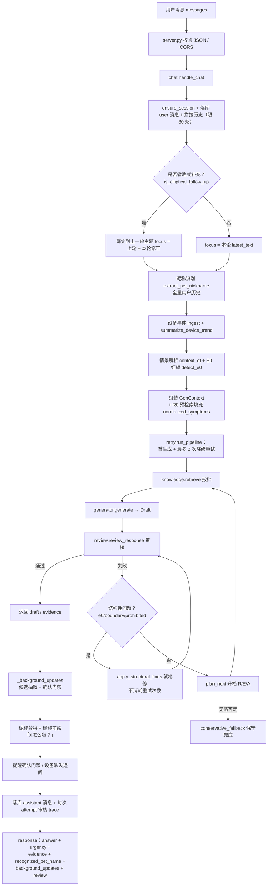

# 猫咪健康对话 Agent — 系统架构与全流程（技术版）

> 本文档描述**当前代码版本**的架构与一次对话的完整数据流，并明确标注上一轮迭代对「昵称先入为主」与「症状幻觉」两个问题的修复点。
> 适用读者：技术评审 / 面试深挖 / 本人维护。产品视角（用户、商业、竞品、MVP）见《猫咪健康 Agent_项目复盘.md》。
>
> 代码根目录：`D:\工作文件\猫咪健康Agent_复原Demo_2026-08-24\`
> 公网 Demo：`https://439ab90a714946e3a26aaaa3155f5f1d.app.workbuddy.link`（本地 `127.0.0.1:8787` 为最新）

---

## 1. 架构一句话定位

一个**受控反射式（Controlled Reflective）Agent**：以「规则引擎 + 权威知识库（RAG）+ 二次审核门禁 + 三层降级重试」替代 LLM 自由生成，做到**确定可复现、证据可追溯、危险绝不误判**。生成环节可插拔——默认离线 `RuleGenerator`，可选 `LLMGenerator`（OpenAI 兼容端点），二者共用同一套审核/重试状态机，且 LLM 缺配置或失败时静默回落规则引擎。

设计信条（来自 SKILL.md / 复盘文档）：
1. **安全优先**：E0 急症红旗硬分流、绝不绕过就医升级。
2. **证据边界**：任何健康建议必须挂在已核验来源上，不得编造未支持事实。
3. **最小采集**：档案/记忆先入候选、用户确认后才写入长期上下文。
4. **保守失败**：证据不足时降级到追问，而不是瞎答。

---

## 2. 模块分层

```
server.py            HTTP 入口（纯标准库 http.server，无第三方依赖）
  │
  └─ engine/chat.py        编排层：会话记忆、焦点绑定、主流程、后台状态、门禁、落库
       ├─ engine/rules.py        情景解析：E0 红旗、昵称、省略句、确认词、提醒三要素、档案候选、设备趋势、症状归一化、分级
       ├─ engine/knowledge.py    知识库：加载、三层别名归一化、检索、红旗强制召回、证据构建、启动自检
       ├─ engine/generator.py    可插拔生成器：RuleGenerator（默认）/ LLMGenerator；GenContext/Draft 契约
       ├─ engine/retry.py        三层降级重试状态机：R0→R1→R2 / E0→E1→E2 / A0→A1→A2
       ├─ engine/review.py       二次审核门禁 + 结构性硬修复 + 保守兜底
       ├─ engine/store.py        SQLite 持久化（WAL、线程安全、按 sessionId 恢复）
       └─ engine/config.py       路径、端口、开关、生成器选择
data/                 knowledge_base_v1.jsonl（14 权威条目）+ fallback_entries.jsonl（3 兜底）+ source_facts.json（16 来源元数据）+ source-registry.md
web/                  index.html（前端单页，每次请求热读）
```

---

## 3. 一次对话的全流程（数据流）

下图是 `POST /api/v1/chat` 触发的完整链路。`handle_chat(payload)` 是编排入口。



### 3.1 逐步说明（对应 chat.py 行号）

| 步骤 | 处理 | 关键函数 / 字段 |
|---|---|---|
| 1 | 取 session、追加 user 消息、取历史（进程内 `_SESSION_MEMORY`，上限 30，进程重启由 `messages` 表恢复） | `store.ensure_session` / `store.append_message` / `_history` |
| 2 | **省略式补充绑定**：若本轮是「突然的」「刚才的」「是的」等，把内容绑到上一轮主题，避免孤立刻板 | `rules.is_elliptical_follow_up` |
| 3 | 档案合并：前端可带 `catProfile`，与库中档案合并 | `store.get_profile` |
| 4 | **昵称识别**（本轮改动核心）：扫描全量用户历史，按 4 层优先级抽取 | `rules.extract_pet_nickname`（见 §4.1） |
| 5 | 设备上下文：摄入 `deviceEvents`，聚合近期趋势 | `store.ingest_device_event` / `rules.summarize_device_trend` |
| 6 | 情景解析：`sudden / time_known / has_companion`，以及 E0 红旗（带否定窗口遮蔽） | `rules.context_of` / `rules.detect_e0` |
| 7 | 组装 `GenContext`，并**先做一次 R0 预检索**填充 `normalized_symptoms`（症状口语归一化，见 §4.2） | `knowledge.retrieve` / `rules.detect_normalized_symptoms` |
| 8 | **生成 + 审核 + 重试**（见 §5） | `retry.run_pipeline` |
| 9 | **后台状态**：档案候选、昵称记忆候选、提醒候选、设备告警候选；自然确认/明确声明触发写档 | `_background_updates`（见 §6） |
| 10 | 昵称替换 + 暖称前缀「X怎么啦？」（仅当名字是推断而来、且答案未主动点名时） | `rules.replace_pet_name` |
| 11 | 提醒确认门禁：用户确认且三要素齐全才建提醒任务 | `store.create_reminder` |
| 12 | 设备缺失/异常追问：仅当 `urgency != E0` 且确实有健康上下文才追问 | `templates.DEVICE_MISSING_QUESTION` |
| 13 | 落库 assistant 消息 + 每次 attempt 的审核 trace（debug 面板可查） | `store.append_message` / `store.log_review` |
| 14 | 组装最终响应，附带 `recognized_pet_name / device_context / background_updates / evidence / review` 供前端展示 | `draft.to_response()` |

---

## 4. 关键机制详解

### 4.1 昵称识别（本轮改动核心）

原始实现（`routers.ts L110-123`）只有「明示叫 X」+「我的/我家 X」两层，且上下文贪婪匹配会把「我的猫今天吐了」错解成名字「猫今」。本轮按用户投诉「不该先入为主、要对常用宠物名有提前考量」做了**正面 + 反面**两向修复。

`extract_pet_nickname(text)` 当前为 **4 层优先级**：

```
1) 明示优先： 「叫/名字是/名叫 X」           _RE_NAMED              → 直接采信
2) 上下文：   「我的/我家/家里的/家中 X」      _RE_CONTEXTUAL          → 贪婪匹配 + 主题词截断兜底
3) 词典兜底： 常见宠物名白名单                _scan_common_pet_name   → 本轮新增
4) 兜底拒识： 以上都未命中                    → 返回 None（不下结论）
```

**反面修复（保守拒识）**：
- `_trim_suffix_to_topic`：若候选末尾把时间词/主题词的前半截粘进来（如「猫」+「今」），截短后长度不足最小昵称长度（2 字）则**返回 None**，丢弃伪候选「猫今」。
- 三层过滤：`NICKNAME_STOPWORDS`（我/你/它/今天…）+ `NICKNAME_GENERIC`（猫/咪/它…）+ `NICKNAME_TOPIC_EXCLUDE`（吐/拉稀/掉毛… 共 60+ 词），任一命中即非昵称。

**正面修复（提前考量常用名）**：
- 新增 `COMMON_PET_NAMES` 白名单（约 130 个常用猫名：咪咪/奶茶/布丁/橘座/大胖/巧克力/小白/小黑…）。
- `_scan_common_pet_name()` 作为第 3 兜底，但**不是先入为主假设名词模式**，而是用语境校验避免误判：
  - 昵称前紧接领属词/称谓（我的|我家|猫咪…）→ 采信；
  - 昵称后紧接症状/主题词（如「奶茶吐了」「咪咪今天…」）→ 视为健康陈述主语，采信；
  - 否则（「我喝了奶茶没养猫」）→ 视为普通词汇，**返回 None**。
- 命中后 `chat.py` 触发暖称前缀「X怎么啦？」，例如 `奶茶吐了` → 「奶茶怎么啦？…」。

> 验证：`我的猫今天吐了` → `recognized_pet_name: None`（反面）；`奶茶吐了` / `咪咪今天吐了`（全新会话）→ 正确识别并暖称（正面）。`tests/smoke.py` 86/86 通过。

### 4.2 症状口语归一化（本轮改动：消除幻觉）

原始 `RuleGenerator` 在 `normalized_symptoms` 为空时会回退到 `top.get("symptoms")[:3]`（知识库条目的主题 symptom 列表），导致 `我的猫今天吐了` 被错误补全成「呕吐**与腹泻**」。

本轮修复：
- `rules._SYMPTOM_ALIASES`：口语→规范词映射（「吐了/吐」→呕吐、「拉稀」→腹泻、「不吃饭」→拒食…）。
- `rules.detect_normalized_symptoms(text, retrieved)`：先做口语归一化，再从**命中条目**的症状词里只挑**真正出现在用户表达**中的；KB 里没精确匹配时用别名规范词兜底补充。
- `generator.py` 优先用 `ctx.normalized_symptoms`，并新增 `ASSERT_A0_OBSERVED_TEMPLATE`（「从你提到的呕吐来看…」），不再罗列未提及症状。

> 验证：`我的猫今天吐了` → `normalized_symptoms: ["呕吐"]`，答案不再出现「腹泻」。

### 4.3 E0 急症硬分流

- `rules.detect_e0`：在 `RED_FLAGS`（张口呼吸/无尿/倒地/持续抽搐/中毒/大量出血/车祸…）+ `FLAG_NORM`（口语折叠，如「尿不出」→无尿）上匹配；前缀 **6 字否定窗口**遮蔽（「没有呼吸困难」不判红旗）。
- 命中即 `urgency = E0`，`next_action = recommend_vet_now`，强制急诊文案 + 安全注意；且 `knowledge.retrieve` 对所有档位**强制召回**对应条目（`FLAG_EVIDENCE_HINTS`），保证证据卡与主题一致。
- 审核器 `review.review_response` 额外校验：E0 答案必须出现「急诊/立即联系/动物医院」，否则 `e0_without_escalation` 触发结构性硬修复。

### 4.4 分级决策表（decide_urgency）

| 条件 | 等级 |
|---|---|
| 命中红旗 flags | E0 |
| 突然 + 有伴随表现 | E1 |
| 突然（无伴随） | E3 |
| 时间线未知 | E3 |
| 无伴随表现 | E2 |
| 否则取命中条目中最保守等级 | min(E0..E3) |

> 风险等级随检索档位变化：R 放宽后命中条目可能改变，`run_pipeline` 每次重试都重新 `decide_urgency(flags, retrieved, context)`。

---

## 5. 三层降级重试（核心：retry.py）

为什么不复刻原状态机？规则引擎是确定性函数，同输入重跑「重新生成」输出一字不差，第二轮必然再次失败。原补救主线本是 `retrieve_again`，这里拆成**三个可独立变化的层**，每次重试都产生真实 diff：

| 层 | 档位 | 含义 | 效果 |
|---|---|---|---|
| 检索档 R | R0 → R1 → R2 | 命中条目池与别名扩展逐档放宽（R1/R2 才开 `EXTRA_ALIASES` 口语层） | 池更广、top_k 更大 |
| 证据档 E | E0 → E1 → E2 | 证据子集逐档变宽（top1 → top3 → 全部 + 补充来源 S09/S03/S12） | 证据更充分 |
| 断言档 A | A0 → A1 → A2 | 结论强度逐档减弱（judgment → observation → uncertain） | 措辞更保守 |

**失败 → 升级映射（plan_next）**：
- `low_confidence_retrieval` / `missing_evidence` → 优先升检索档 R，再升证据档 E
- `judgment_not_supported` → 升证据档 E，再升断言档 A
- `missing_evidence_excerpt` → 升检索档 R / 证据档 E

**结构性失败（不消耗重试次数）**：`e0_without_escalation` / `missing_diagnosis_boundary` / `prohibited_action` 由 `review.apply_structural_fixes` 就地修复（如把「自行催吐」删掉、补诊断边界声明），修复后**重新审核**一遍。

**终止条件**：3 次 attempt 仍不通过 → `conservative_fallback`：非空回答 + 追问 + 安全注意 + 就医升级提示，且保留已检索出处，绝不空答或幻觉。

**审核器（review.py）** 另带**否定语境遮蔽**：原实现 `prohibited_action` 是无语境子串匹配，会把知识库 `must_not` 原文「不自行给药」误判违规；现用 `NEGATION_HINTS`（不要/别/切勿/禁止…）前缀遮蔽，仅当违规词**未被否定**才记为问题。

---

## 6. 后台状态与确认门禁（最小化采集）

所有从对话中抽取的个人信息都先入**候选层**，用户确认/自然确认后才写长期档案（`store.py` 候选生命周期：`candidate → confirmed | deleted`）：

- **档案候选**：`name/age/breed/sex/neutered/diet/medicalHistory/allergies/dailyHabits`，由 `rules.extract_profile_candidates` 抽取。
  - 自然确认词（好的/可以/确认…）→ 确认所有待确认**身份**字段（name/age/breed/sex/neutered）。
  - 明确说出名字（「叫小白」）→ 只确认 name，不越权确认其他字段。
- **记忆候选**：昵称（推断得出且未声明档案时）+ 稳定信息（饮食/病史/过敏/习惯）。
- **提醒候选**：检测到提醒意图只登记，三要素（内容/时间/时区）齐全才经确认门禁创建任务。
- **设备告警**：趋势命中 `下降|增加|异常|无尿…` 时登记，前端追问。

**本轮改动**：系统确认的候选（profile/memory pending question）**不再作为「下一步你可以问我」的追问推给用户**——避免打断对话、避免与暖称重复。候选仍在 `_background_updates` 中持久化，确认门禁逻辑保留（见 `chat.py` 移除 `PROFILE_PENDING_QUESTION`/`MEMORY_PENDING_QUESTION` 追加的改动，注释「档案/记忆候选仍会在 _background_updates 中持久化，不再作为追问推给用户」）。

---

## 7. 知识库与证据可信度（knowledge.py）

- **加载**：`knowledge_base_v1.jsonl`（14 权威条目）+ `fallback_entries.jsonl`（3 兜底）= 17 条；`source_facts.json` 16 条已核验来源元数据（机构/标题/URL/checked_at/facts）。
- **三层别名归一化**：
  - 第 1 层 `ROUTERS_ALIASES_VERBATIM`：原实现照抄；
  - 第 2 层 `CANONICAL_FIX`：把原实现的死别名（食欲不振/进出猫砂盆/精神下降/行为或意识改变）重定向到库内真实术语；
  - 第 3 层 `EXTRA_ALIASES`：口语扩展（目标词 100% 取自库内术语，启动自检强校验）。
- **红旗强制召回**：`FLAG_EVIDENCE_HINTS`，命中红旗时无视检索分数强制拿到对应条目，来源必须落在条目 `source_ids` 并集内（启动自检）。
- **证据构建**：`build_evidence` 以 `source_facts.json` 为唯一来源真源，输出带 `organization/title/url/excerpts/boundary` 的证据卡。
- **启动自检 `self_check`**：权威文件 sha256 校验（防误改）、条目完整性、别名目标词必须存在、红旗来源不越界、条目引用来源全部已核验。任一致命项抛 `KnowledgeBaseError` 阻断启动。

---

## 8. 生成器可插拔（generator.py）

- `GenContext` / `Draft` 是审核器与重试状态机唯一依赖的契约。
- `RuleGenerator`（默认，离线）：模板 + 槽位组装，确定性（同输入同输出）。
- `LLMGenerator`（可选）：OpenAI 兼容端点，`response_format=json_schema` 强约束；**失败时一律回落 `RuleGenerator`，异常绝不暴露给用户**。
- 切换：`CAT_AGENT_GENERATOR=rule|llm`（默认 rule）；llm 缺 `BASE_URL`/`MODEL` 静默回落 rule。
- 同一个 `run_pipeline` 状态机原地升级为真正的「重新生成」闭环——接上 LLM 后，E0 硬分流、证据边界、禁止词形等门禁照常生效。

---

## 9. 部署与运行

- `server.py`：纯标准库 `http.server`，**无第三方依赖**，无需 `requirements.txt`。
- 端点：`GET /`、`/api/v1/health`、`/api/v1/bootstrap`、`POST /api/v1/chat`、`POST /api/v1/reset`、`GET /api/v1/attempts/:id`（debug 面板）。
- 端口：`0.0.0.0` + 注入 `$PORT`（发布沙箱）或 `127.0.0.1:8787`（本地）；绑定失败自动 +1，最多试 10 次。
- 前端热更新：`/` 每次请求重新读 `index.html`，改前端无需重启。
- 缓存策略：`Cache-Control: no-store`，避免预览面板读到旧内容。
- 公网发布：`workbuddy_sites_deploy` 复用沙箱——**改完代码必须「先下线 → 再全新发布」**才能刷新线上（平台缓存 bug，否则线上显示旧内容）。

---

## 10. 本轮架构改动清单（相对上一版 / 原始 routers.ts）

| # | 改动 | 位置 | 解决的问题 |
|---|---|---|---|
| 1 | 昵称保守拒识：`_trim_suffix_to_topic` 截短不足最小长度返回 `None` | `rules.py` | 「我的猫今天吐了」误识别成「猫今」 |
| 2 | 新增 `COMMON_PET_NAMES` 白名单 + `_scan_common_pet_name` 词典兜底（第 3 层） | `rules.py` | 用户投诉「先入为主、未对常用宠物名提前考量」 |
| 3 | 暖称前缀「X怎么啦？」 | `chat.py` | 推断名字时对话更自然、点名不突兀 |
| 4 | `_SYMPTOM_ALIASES` 症状口语归一化 + `detect_normalized_symptoms` 只挑真出现 | `rules.py` / `generator.py` | 「呕吐与腹泻」幻觉（未提及症状被补全） |
| 5 | `ASSERT_A0_OBSERVED_TEMPLATE` 观察式措辞 | `templates.py` / `generator.py` | 结论不罗列未提及症状 |
| 6 | 移除系统确认追问污染「下一步你可以问我」 | `chat.py` | profile/memory pending 与对话打断、与暖称重复 |
| 7 | 设备追问措辞 reword：「它最近一次…」 | `templates.py` / `chat.py` | 原「另外，方便告诉我…」机器味重 |

> 测试：`tests/smoke.py` 全量 **86/86 通过**（含本轮新增 8 个昵称/症状用例）。

---

## 11. 能力迁移（面试讲述锚点）

虽领域是宠物健康，但本架构验证了消费 AI 产品方向可迁移的四项能力：
1. **安全与边界感** → E0 硬分流 + 否定窗口 = 消费 AI 的「风险提示/合规红线」。
2. **多轮交互设计** → 省略式补充绑定 + E1–E3 追问 + 确认门禁 = Agent「对话状态管理/主动追问」。
3. **证据可信度** → RAG + 已核验来源 + 诊断边界 + 三层降级 = 「幻觉控制/引用可追溯」方法论。
4. **隐私与授权** → 候选→确认门禁 = 「用户数据授权/最小化采集」。

**一句话总结**：信任不来自「诊断多准」，而来自「危险时绝不误判」。
